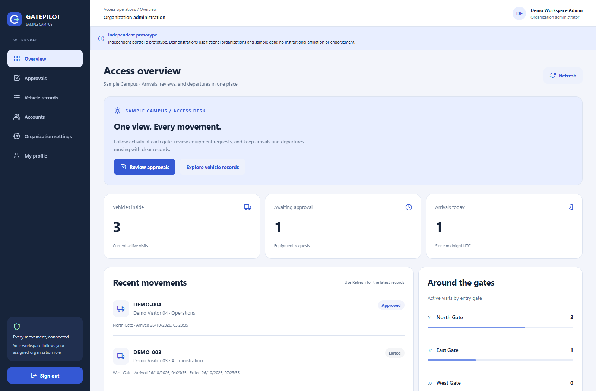
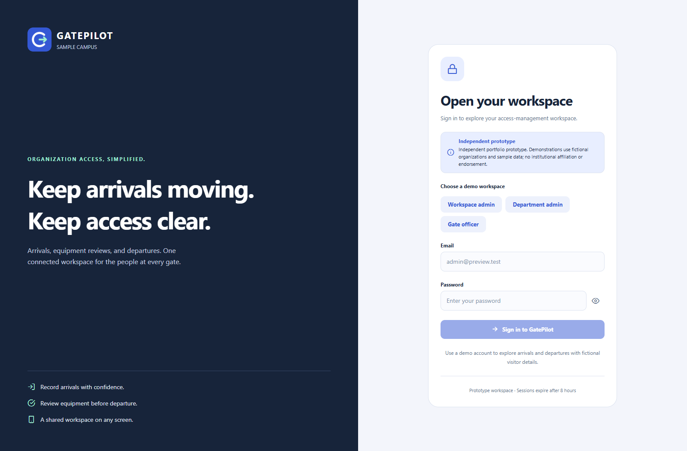
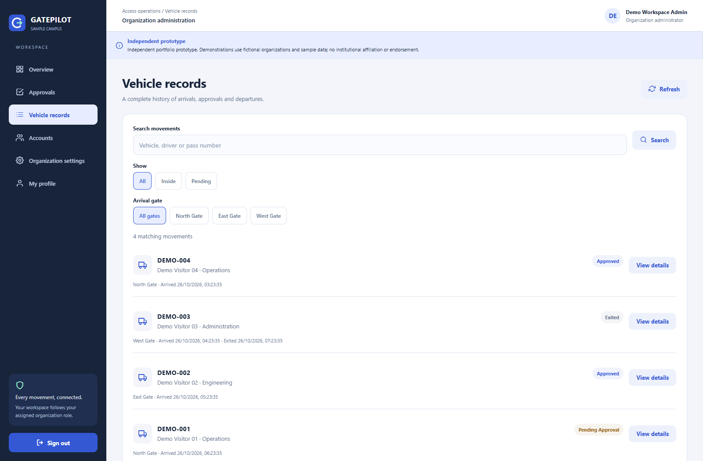
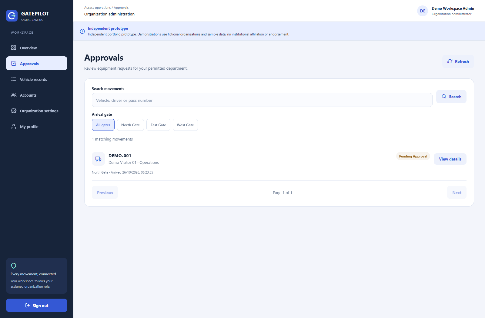
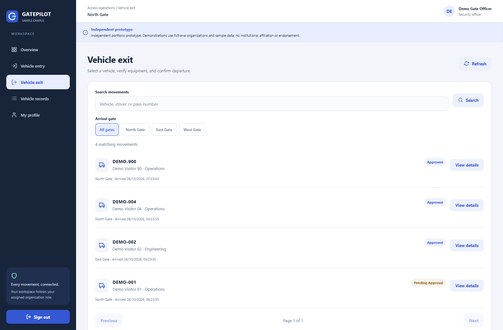
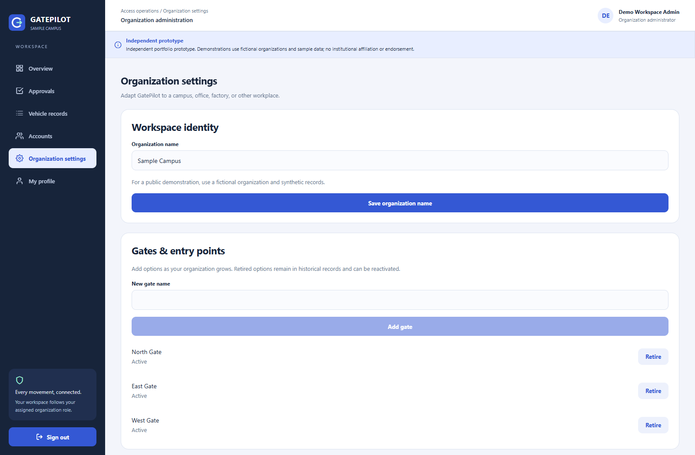
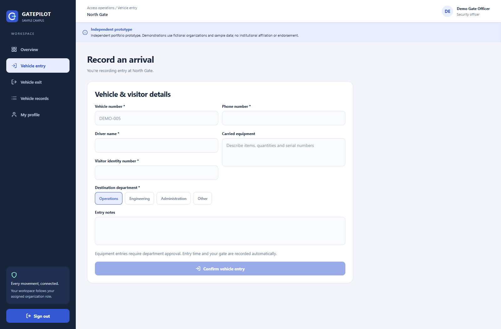
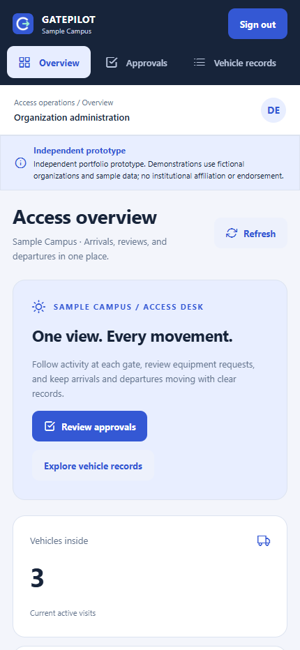

# GatePilot

GatePilot is an independent campus and workplace gate-management prototype. Sample Campus and all demo identities are fictional; there is no institutional affiliation or endorsement.

## Features

- Secure sign-in, sign-out and password changes.
- Vehicle arrivals and departures, with the officer’s gate and server time recorded automatically.
- Department approval for carried equipment, including rejection and resubmission.
- A dashboard and searchable vehicle records with status filters, gate filters and pagination.
- Administrator-managed accounts, organization name, gates and departments.

The same React Native / Expo screens work in the browser and adapt to mobile screen sizes. The signed-in user’s name appears in the workspace header.

## Run the demo

Install Node.js 22.13 or newer. In the project folder, run:

```powershell
.\Start-GatePilot.ps1 install
.\Start-GatePilot.ps1 demo
```

Keep that terminal open. In another terminal, run:

```powershell
.\Start-GatePilot.ps1 web
```

Open http://localhost:8081. The first command may download a MongoDB binary for the temporary demo database. If MongoDB is already installed elsewhere, set `MONGOMS_SYSTEM_BINARY` to its executable path.

The demo terminal prints one generated password for these fictional accounts:

| Account                | Role                       | What to demonstrate                                          |
| ---------------------- | -------------------------- | ------------------------------------------------------------ |
| `officer@preview.test` | Gate officer               | Record an arrival and verify departure at North Gate.        |
| `manager@preview.test` | Department administrator   | Approve or reject Operations equipment requests.             |
| `admin@preview.test`   | Organization administrator | Review all departments, manage accounts and configure gates. |

For an interview demo: sign in as the officer, enter a fictional vehicle with equipment, sign out, approve it as the manager, then return as the officer and verify the equipment before confirming departure. Refresh the dashboard to see the new counts. A vehicle without equipment can depart without administrator review.

Demo mode never loads the backend `.env` or opens your saved database. Stopping it discards only its temporary demo data.

On other systems, run `npm ci` in both `backend` and `frontend`, then `npm run demo` in `backend` and `npm run web` in `frontend`.

## Local Docker option

With Docker Desktop running in Linux-container mode:

```powershell
.\Start-GatePilot.ps1 docker
```

Open http://localhost:8080. First startup creates fictional accounts and prints their initial password. Later starts preserve saved records and passwords.

- `docker-status`: show service status.
- `docker-credentials`: show the initial password; changed passwords are not reset.
- `docker-stop`: stop containers while keeping their database volume.

Use these mode names with `Start-GatePilot.ps1`. Keep the ignored `.docker/secrets` folder: its credentials are required to reopen the saved database. The database and API are internal; only the web service is exposed to this computer. This local HTTP configuration is not an internet deployment configuration.

## How the code works

1. `frontend/App.jsx` restores the session or shows sign-in.
2. `frontend/src/Workspace.jsx` shows the pages allowed for the signed-in role.
3. A screen sends a request through `frontend/src/api.js`.
4. Express checks the session, role and input, then reads or updates MongoDB.
5. The screen refreshes its records. Equipment approval is required before a matching visit can close.

| Folder                             | Purpose                                                                      |
| ---------------------------------- | ---------------------------------------------------------------------------- |
| `frontend/src/screens`             | Forms and pages for the main workflows.                                      |
| `frontend/src/components`, `hooks` | Reused UI and loading logic.                                                 |
| `backend/src/routes`               | Authentication, accounts, settings, dashboard and vehicle endpoints.         |
| `backend/src/models.js`            | Four database models: User, Session, VehicleRecord and OrganizationSettings. |
| `backend/test`, `frontend/test`    | Security, workflow and pagination tests.                                     |
| `docker`, `scripts`                | Optional local Docker setup.                                                 |
| `docs/screenshots`                 | Current desktop and mobile web screenshots.                                  |

The main helper names describe their jobs: `requireSession` checks sign-in, `allowRoles` checks permissions, and `getDepartmentFilter` limits department data. Screen actions such as `saveProfile` and `updateRecord` call the API directly. Shared visual rules live in `frontend/src/ui.jsx` as `styles`; page-specific styles stay with their screen.

## Checks

```powershell
.\Start-GatePilot.ps1 test
.\Start-GatePilot.ps1 build
```

Tests use temporary MongoDB. The build exports web, Android and iOS bundles; it does not produce signed native installers or test physical devices. Generated output folders are ignored by Git. Start and build commands clear Metro’s cache so an earlier API URL is not reused.

For individual checks, run `npm test` in `backend`; run `npm run lint`, `npm test`, `npm run format:check`, `npm run build` and `npm run build:mobile` in `frontend`.

Frontend installation applies version-checked security protections to two Expo tooling dependencies. Keep install scripts enabled; their regression tests must pass. Package scanners may still flag the published versions because local protections do not change package metadata.

## Saved databases and security

Use `backend/.env.example` and `frontend/.env.example` for a separate development database. Set `MONGO_URI`, exact `WEB_ORIGINS` and the frontend API URL, then run `npm start` in `backend`. Native release bundles require an HTTPS API URL.

Create an initial administrator with `ADMIN_EMAIL`, `ADMIN_PASSWORD` and `node seed.js` in `backend`. The seed refuses to replace an existing account. For account recovery, use `RESET_EMAIL`, `RESET_PASSWORD` and `node scripts/reset-password.js`; remove temporary password variables after use.

Existing database records and collections are preserved. This app does not run a destructive migration. Gate and department retirement keeps historical visits, checks linked accounts and prevents retiring departments with open visits. A unique index prevents duplicate active visits; conditional updates prevent double approval or stale departures. Dashboard day counts use UTC and timestamps display in the device’s timezone.

See [SECURITY.md](SECURITY.md) for deployment limits. Obtain the relevant ownership and publication permissions before sharing assigned or group work.

## Screenshots

These images show the verified isolated demo. All identities are fictional. The mobile image is the responsive web layout.



<details>
<summary>More desktop screens</summary>













</details>


